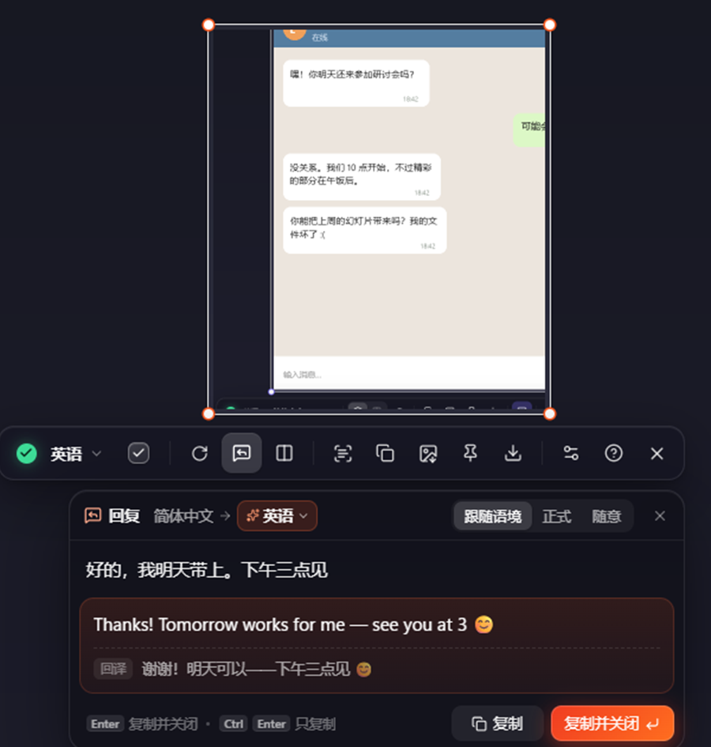
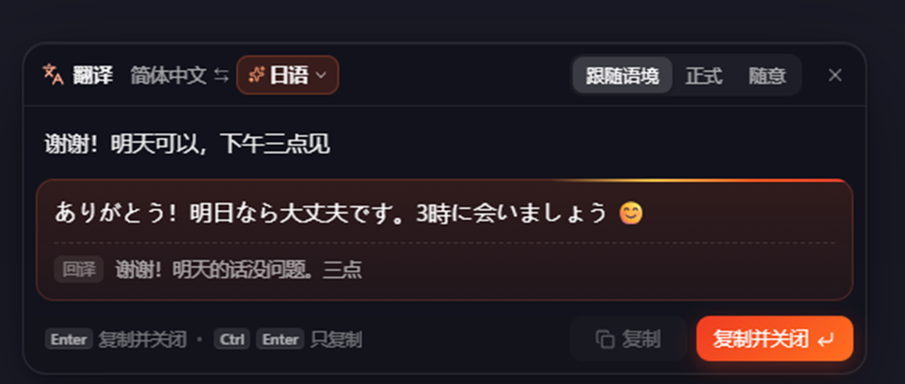
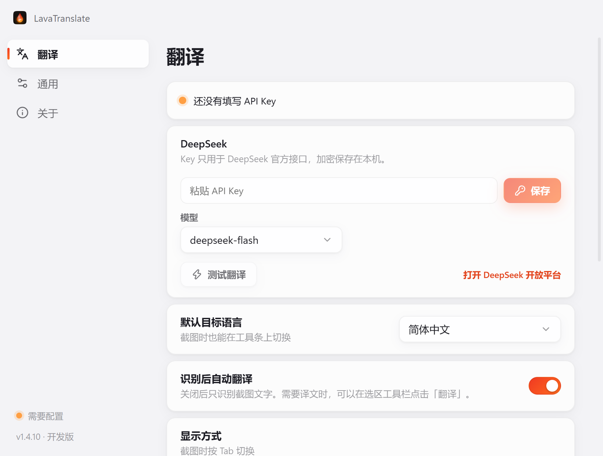

<p align="center">
  
</p>

<h1 align="center">LavaTranslate</h1>

<p align="center">
  <b>Select any part of your screen — the translation appears right on top of it, in the same layout.</b><br>
  Then answer foreign-language chats in your own language.
</p>

<p align="center">
  <a href="https://github.com/Misaka-ops/LavaTranslate/releases/latest"></a>
  <a href="https://github.com/Misaka-ops/LavaTranslate/releases"></a>
</p>

<p align="center"><b>English</b> · <a href="README.zh-CN.md">简体中文</a></p>

<p align="center">Windows 10/11 · x64</p>

---


## Download and install

| Platform | Download | First translation |
| --- | --- | --- |
| Windows 10/11 · x64 | [Windows installer (.exe), v1.4.11](https://github.com/Misaka-ops/LavaTranslate/releases/download/v1.4.11/LavaTranslate-Setup-1.4.11.exe) | Press **Win + Space** and drag over text to recognize it. Double-click the tray icon to configure a translation service. |

The Windows installer is unsigned. If SmartScreen shows **Unknown publisher**, use **More info → Run anyway** after checking that the file came from the release linked above.

## Why LavaTranslate

Most screenshot translators show a list of sentences in a separate window, so you have to match each one back to the screen. LavaTranslate puts every translated line **exactly where the original was**:

- **Same position, size, color, weight and alignment.** Each line keeps its font size (measured from the actual stroke height), text color (robust to ClearType fringes), bold or regular weight, and left/center/right alignment. Paragraphs that wrap around images keep their shape.
- **Icons stay visible.** Arrows, stars, list numbers and other icons that OCR mistakes for letters are not painted over.
- **The model looks at the screenshot itself.** OCR runs locally; a vision model then fixes recognition errors, merges wrapped lines into paragraphs, and leaves code, commands, URLs, @handles and brand names untranslated.
- **Translations appear block by block.** Windows tries DirectML for local OCR and falls back to the CPU.


## Reply assistant

You can read the other person's message now — LavaTranslate also helps you answer it.



- When the screenshot is a **chat, DM, comment thread or email**, a reply box opens under the toolbar after the translation finishes. Press <kbd>R</kbd> to open it anytime.
- Type in your own language. It starts translating after a short pause. **Auto** translates into the language detected on screen; open the language menu to pick any other language instead (your choice holds until you take a new screenshot).
- Pick a tone: **Match the conversation**, **Formal** or **Casual**. The model reads the conversation on screen to get the wording and form of address right.
- A **back-translation** below the result shows you what you are actually sending.
- <kbd>Enter</kbd> copies and closes so you can paste straight into the chat. **Ctrl + Enter** copies and keeps the reply box open. **Shift + Enter** adds a new line, and **↑ / ↓** recall previous replies.

<br clear="right">

## Type to translate

Press your capture shortcut **twice** to translate typed text. The default is **Win + Space**. Translation starts after a pause of about two seconds, or immediately when you press <kbd>Enter</kbd>. **Auto** translates between your interface language and the foreign language you last used. Choose a language from the menu to translate everything you type into that language. LavaTranslate remembers your choice. When the translation is ready, <kbd>Enter</kbd> copies it and closes the window.



## Setup: add a DeepSeek API key

Double-click the tray icon to open **Settings**. On the **Translate** page, paste your DeepSeek API key, click **Save**, then **Test**. The interface follows your system language by default and offers 12 languages under **General**.

There are three fixed models, selectable in Settings:

- **`deepseek-flash`** (default): reads images, about 1 s to first token, half price off-peak;
- **`deepseek-chat`**: the general chat model;
- **`deepseek-reasoner`**: a reasoning model that thinks before writing, slower for everyday screenshot translation.

Create a key at the [DeepSeek Platform](https://platform.deepseek.com/api_keys). The app only calls the official DeepSeek API, and the key is stored encrypted with safeStorage/DPAPI.



> **About this fork:** a trimmed, personal Windows build that supports DeepSeek only. ChatGPT-plan sign-in, other providers, the model price list, key detection, local credential import and the offline-translation survey have been removed. Automatic updates are off by default so an upstream build cannot overwrite this fork; enabling them in About would install the upstream multi-provider version.

## Shortcuts

| Action | Windows |
| --- | --- |
| Start a capture | **Win + Space** or click the tray icon |
| Translate typed text | Press the capture shortcut twice |
| Open Settings | Double-click the tray icon |
| Show the original while held | Alt |
| Copy all translations / all original text | Ctrl + C / Alt + C |
| Copy / save the translated image | Ctrl + Shift + C / Ctrl + S |
| Pin the translation / original | F3 / Alt + F3 |
| Translate the selection again | Ctrl + R |

On either desktop, drag to select a region, or click to select a window. Drag the selection or its handles to move or resize it. Hold **Space** to interact with the app underneath, then release to capture the same area again.

- **Tab** switches between in-place and side-by-side views. **R** opens the reply assistant.
- Click a block to copy its translation. **Enter** copies all translations and closes. Double-click the selection to copy it as an image and close. Hold **Alt** while double-clicking to copy the original image.
- Drag a pin to move it, scroll to zoom and double-click to close. Choose **Always on top** in the pin toolbar to keep it above other windows.
- Right-click or press **Esc** to exit the capture.

## Privacy

- OCR runs on your device. The selected region (image and recognized text) is sent only to the DeepSeek service you configure. Reply and type-to-translate requests also send the text you enter. Recent replies are stored locally so you can recall them with the arrow keys.
- **Windows** uses Electron’s `safeStorage` (DPAPI) for API keys when system encryption is available.

## Updates

**Windows installer**

- LavaTranslate checks this repository's Releases **20 seconds after it starts and then every 4 hours**. To check manually, open **Check for updates** from the tray menu or **Settings → About**.
- A new version downloads in the background. Only the parts of the installer that changed are downloaded.
- When it's ready you get a notification, and **Restart & update to vX** appears in the tray menu and on the About page. If you don't restart, it installs the next time you quit.
- The version and update status are also shown at the bottom of the Settings sidebar; click them to open the About page. Turn automatic updates off in Settings → About.

## FAQ

**Can I use ChatGPT, Gemini or other models?**
This trimmed fork supports DeepSeek only. ChatGPT-plan sign-in and the other providers have been removed; use the upstream project if you need them.

**Translation feels slow?**
Keep the default `deepseek-flash`. `deepseek-reasoner` thinks before writing, so everyday screenshot translation is noticeably slower.

**The translation is slow.**
Choose a smaller model (marked 快 / fast). Reasoning-heavy models spend seconds thinking before they write.

**Which languages are supported?**
The local OCR reads Chinese, Japanese, English and other Latin-script languages, Cyrillic and more. A vision model reads anything the OCR can't (for example Korean) straight from the screenshot. You can translate into any language you pick on the toolbar.

**How do I uninstall on Windows?**
Go to Windows Settings → Apps → LavaTranslate → Uninstall.

## Build from source

Requirements: Windows 10/11 x64, Node.js 22+, and Python 3 with `onnx` (optional, used to patch the OCR model for speed). Windows packaging downloads and verifies a pinned Microsoft VC++ x64 runtime and bundles it beside the executable. The first build needs internet access; subsequent builds can use the local cache. See [runtime preparation and diagnostics](docs/DEVELOPMENT.md#windows-运行库与启动诊断).

```bash
npm install
npm run models   # download the PP-OCRv6 models (~30 MB)
npm run dev      # run in development mode
npm run dist     # build the NSIS installer into dist/
```

These commands build the Windows x64 installer.

The desktop app uses Electron, React and Motion. ONNX Runtime runs the local [PaddleOCR PP-OCRv6](https://github.com/PaddlePaddle/PaddleOCR) models.

## License

[MIT](LICENSE) © 2026 chengcczzjj

---

<p align="center">Bug reports and ideas: <a href="https://github.com/Misaka-ops/LavaTranslate/issues">Issues</a></p>
