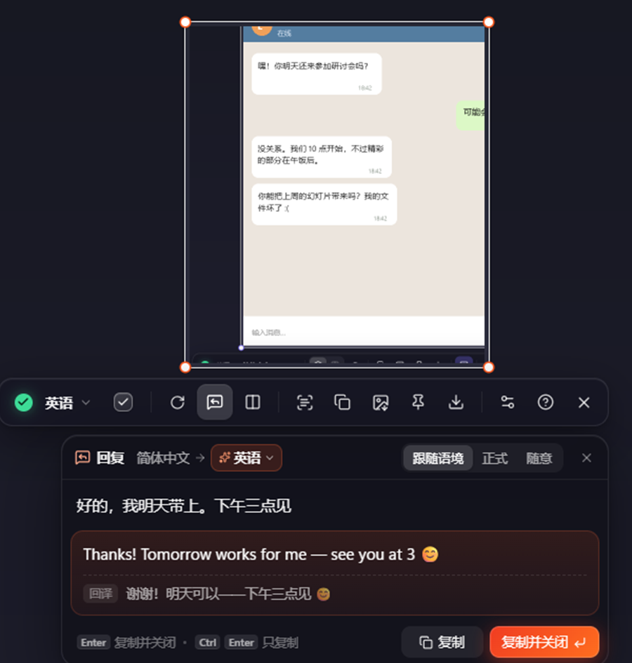
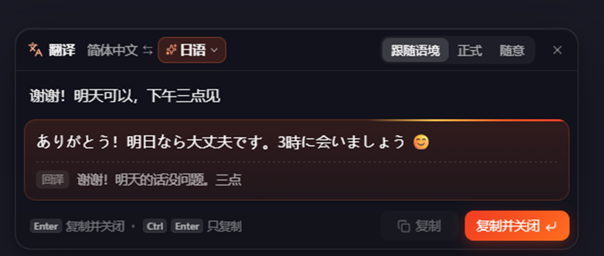
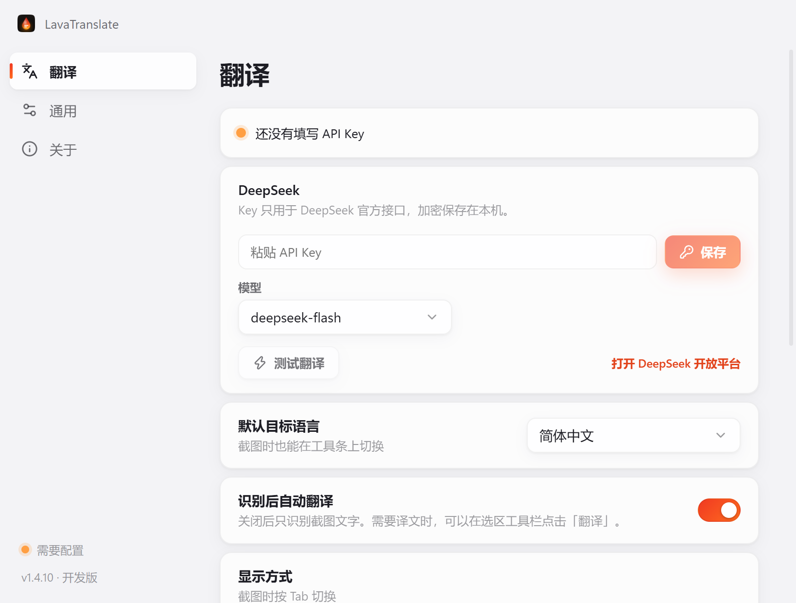

<p align="center">
  
</p>

<h1 align="center">LavaTranslate</h1>

<p align="center">
  <b>框选屏幕任意区域，译文按原来的排版直接盖在原文上。</b><br>
  看懂外语聊天后，还能用自己的语言直接回复。
</p>

<p align="center">
  <a href="https://github.com/Misaka-ops/LavaTranslate/releases/latest"></a>
  <a href="https://github.com/Misaka-ops/LavaTranslate/releases"></a>
</p>

<p align="center"><a href="README.md">English</a> · <b>简体中文</b></p>

<p align="center">Windows 10/11 · x64</p>

---


## 下载安装

| 平台 | 下载入口 | 第一次翻译 |
| --- | --- | --- |
| Windows 10/11 · x64 | [Windows 安装程序（.exe），v1.4.11](https://github.com/Misaka-ops/LavaTranslate/releases/download/v1.4.11/LavaTranslate-Setup-1.4.11.exe) | 按 **Win + 空格**，拖动框选即可识别文字。双击托盘图标可配置翻译服务。 |

Windows 安装程序尚未签名。如果 SmartScreen 显示「未知发布者」，确认文件来自上方发布链接后，可点「更多信息 → 仍要运行」。

## 有什么不一样

一般的截图翻译把结果列在另一个窗口里，你得一句句对回屏幕上去找。LavaTranslate 把每一行译文**放回原文所在的位置**：

- **位置、字号、颜色、粗细、对齐都和原文一致**：字号按笔画的实际高度推算，文字颜色能抵消 ClearType 的彩色边，粗体常规分得清，左对齐、居中、右对齐都保持，绕图排列的段落也保持原来的形状；
- **图标不会被盖掉**：被 OCR 误认成字符的箭头、星星、列表序号都保留可见；
- **模型会看截图**：文字识别在本地完成，再由支持看图的模型纠正识别错误、把折行的句子合成段落，代码、命令、网址、@用户名、品牌名保持原样不翻；
- **译文逐段出现**。Windows 本地文字识别优先使用 DirectML，可回退到 CPU。


## 回复助手

看懂了对方的消息，接下来就是回复。



- 截图是**聊天、私信、评论、邮件**这类对话时，翻译完成后工具条下方会自动出现回复框；任何时候按 <kbd>R</kbd> 也能打开；
- 用自己的语言输入，停顿片刻就开始翻译。「自动」时译成截图里识别出的对方语言；也可以在语言菜单里手动选任意语言（这张截图里一直有效，换一张截图回到自动）；
- 语气可选「跟随语境 / 正式 / 随意」，模型会参照屏幕上的对话决定措辞和称呼；
- 译文下方附**回译**：再翻回你的语言，不懂对方的语言也能确认意思没变；
- <kbd>Enter</kbd> 复制并关闭，回到聊天软件就能粘贴。**Ctrl + Enter**复制并保留回复框。**Shift + Enter** 换行，**↑ / ↓** 翻看之前的回复。

<br clear="right">

## 输入文字翻译

**连按两次截图快捷键**就能直接输入文字翻译。默认是 **Win + 空格**。停顿约两秒后开始翻译，也可以按 <kbd>Enter</kbd> 立即翻译。「自动」会在界面语言和上次使用的外语之间互译。想固定目标语言，可以从菜单里选，之后输入的文字都会译成它，下次打开还记得。译好后按 <kbd>Enter</kbd> 即可复制并关闭。



## 配置：填一个 DeepSeek API Key

双击托盘图标打开「设置」。在「翻译」页填入 DeepSeek API Key，点「保存」，再点「测试翻译」即可。界面默认跟随系统语言，也可以在「通用」中从 12 种界面语言里选择。

模型固定三档，在设置页的下拉框里切换：

- **`deepseek-flash`**（默认）：能看图，首字约 1 秒，非高峰时段半价；
- **`deepseek-chat`**：通用的对话模型；
- **`deepseek-reasoner`**：推理模型，写之前会先思考几秒，适合难句，日常截图翻译会慢一些。

在 [DeepSeek 开放平台](https://platform.deepseek.com/api_keys) 创建 Key。软件只调用 DeepSeek 官方接口，Key 加密保存在本机（safeStorage/DPAPI）。



> **本分支说明**：这是面向个人使用的 Windows 精简版，只支持 DeepSeek。ChatGPT 会员登录、其他服务商、模型价格列表、Key 自动识别、本机凭据导入和离线翻译意向投票都已移除。自动更新默认关闭，避免被上游版本覆盖（可在「关于」里打开，但更新会装回上游多服务商版本）。

## 快捷键

| 操作 | Windows |
| --- | --- |
| 开始截图 | **Win + 空格**，或单击托盘图标 |
| 输入文字翻译 | 连按两次截图快捷键 |
| 打开设置 | 双击托盘图标 |
| 按住查看原文 | Alt |
| 复制全部译文 / 原文 | Ctrl + C / Alt + C |
| 复制译图 / 保存译图 | Ctrl + Shift + C / Ctrl + S |
| 钉译图 / 钉原图 | F3 / Alt + F3 |
| 重新翻译选区 | Ctrl + R |

Windows 上可以拖动框选，也可以单击选中鼠标下的窗口。拖动选区或边缘手柄可以移动、缩放选区。按住**空格**可操作下方应用，松开后重新截取同一区域。

- **Tab** 切换原位覆盖和并排对照，**R** 打开回复助手。
- 单击一段译文可复制该段，**Enter** 复制全部译文并关闭。双击选区可复制当前图片并关闭，同时按住 **Alt** 可复制原图。
- 钉图可拖动、滚轮缩放，双击关闭。需要一直显示在其他窗口上方时，点钉图工具条上的「置顶」。
- 右键或按 **Esc** 退出截图。

## 隐私

- 文字识别在设备本地完成。把选区图片和识别出的文字发送给你配置的 DeepSeek。回复和输入翻译也会发送你输入的文字。最近用过的回复保存在本机，方便用方向键调出。
- **Windows** 在系统加密可用时，通过 Electron 的 `safeStorage`（DPAPI）加密 API Key。

## 自动更新

**Windows 安装版**

- 软件在**启动 20 秒后检查一次，之后每 4 小时检查一次**本仓库的 Releases。也可从托盘菜单或「设置 → 关于」中选择「检查更新」。
- 发现新版本会在后台下载，只下载安装包里有变化的部分；
- 下载完成后弹出通知，托盘菜单和「关于」页出现「**重启并更新到 vX**」，点一下立即更新；不点的话，下次退出软件时自动安装；
- 设置窗口左下角显示当前版本和更新状态，点它直接跳到「关于」页；在「关于」页可以关闭自动更新。

## 常见问题

**能用 ChatGPT / Gemini 等其他模型吗？**
这个精简分支只支持 DeepSeek，其他服务商和 ChatGPT 会员登录已移除。需要多服务商请使用上游版本。

**翻译比较慢？**
用默认的 `deepseek-flash`；`deepseek-reasoner` 写之前要先思考好几秒，日常翻译会明显慢一些。

**支持哪些语言？**
本地 OCR 能识别中文、日文、英文等拉丁字母语言、俄文等；OCR 认不出的文字（比如韩文）由能看图的模型直接从截图里读出来。译成什么语言，在工具条上随时切换。

**Windows 版怎么卸载？**
Windows 设置 → 应用 → LavaTranslate → 卸载。

## 从源码构建

需要 Windows 10/11 x64、Node.js 22 以上；有 Python 3 和 `onnx` 时会顺便给 OCR 模型打加速补丁（可选）。Windows 打包会自动从微软下载并校验固定版本的 VC++ x64 运行库，放在应用目录随包分发；首次打包需要联网，缓存后可离线打包。离线准备和故障排查见 [开发文档](docs/DEVELOPMENT.md#windows-运行库与启动诊断)。

```bash
npm install
npm run models   # 下载 PP-OCRv6 模型（约 30 MB）
npm run dev      # 开发模式运行
npm run dist     # 打包 NSIS 安装程序到 dist/
```

以上命令生成 Windows x64 安装包。

桌面版使用 Electron、React 和 Motion，通过 ONNX Runtime 运行本地的 [PaddleOCR PP-OCRv6](https://github.com/PaddlePaddle/PaddleOCR) 模型。

## 许可证

[MIT](LICENSE) © 2026 chengcczzjj

---

<p align="center">问题和建议欢迎提 <a href="https://github.com/Misaka-ops/LavaTranslate/issues">Issues</a></p>
